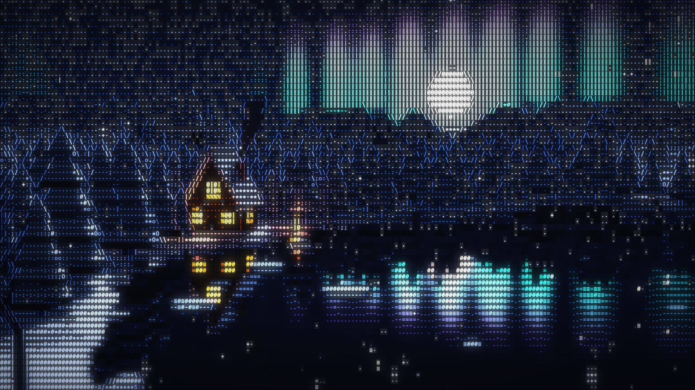
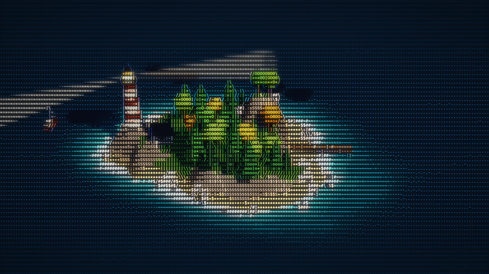
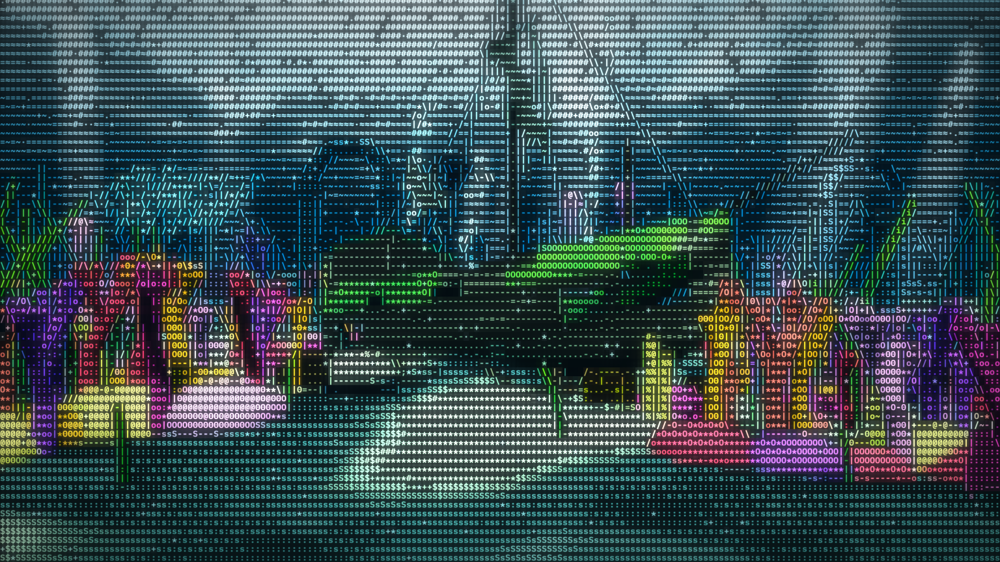
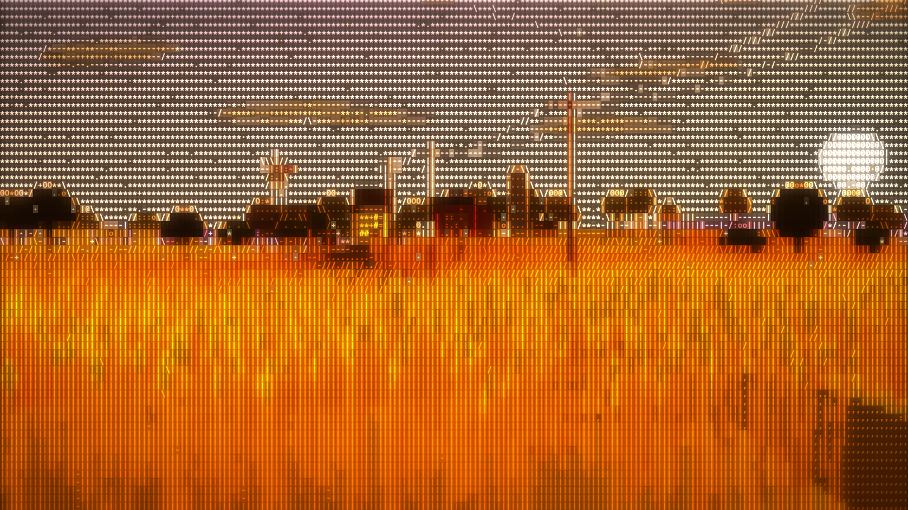

# Noxe ASCII Engine

Real-time 3D scenes redrawn as coloured characters, right in the browser. Build a scene in [three.js](https://threejs.org) and the engine turns every frame into living ASCII art: brightness picks the character, surfaces and edges pick their own glyphs, and the whole thing runs at full frame rate.



| Island | Shipwreck reef | Wheat farm |
|---|---|---|
|  |  |  |

## Features

- **A real 3D pipeline under the characters.** Lights, shadows, fog, reflections and animation all happen in three.js first, then get converted to glyphs.
- **Glyph sets per material.** Water, foliage, snow, fire, wood and 20 more sets, each with its own character ramp. Tag any mesh or material and it draws with that set.
- **Edge-aware.** Silhouettes and creases are detected per pixel and drawn as line glyphs (`- / | \`), so shapes stay readable.
- **Oriented strokes.** Grass and wheat draw their strokes along the way each blade leans, and they follow the wind.
- **Particles in the character grid.** Snow, sparks and bubbles live in the 3D scene and hide behind nearer objects.
- **Look controls.** Exposure, saturation, bloom, tilt-shift, vignette, grain, cell size and font, all live in the panel and remembered per scene.
- **Export.** Save PNG frames or record MP4 video, including fixed 1920×1080 and 1080×1920 sizes for posting to X.
- **Bring your own model.** Drop a `.glb` file on the page and it gets glyph sets guessed from its material names.
- **No build step.** Plain ES modules. Open the page and go.

## Quick start

You need Python 3 (already on macOS) and a browser with WebGL 2. Chrome or Edge is recommended, since they can record MP4.

```bash
git clone https://github.com/danieljan-design/noxe-ascii-engine.git
cd noxe-ascii-engine
python3 serve.py
```

Then open http://localhost:5183.

`serve.py` is a tiny local server with caching turned off, so a reload always picks up your code changes. Any static file server works too. three.js and lil-gui load from the jsDelivr CDN, so you need an internet connection the first time.

### Controls

| Input | Action |
|---|---|
| Drag | Orbit the camera |
| Scroll | Zoom |
| Click | Scene interaction (see below) |
| `H` | Hide the panel |
| `Space` | Pause |
| `P` | Save a PNG |
| Drop a `.glb` | Load your own model into the Stage scene |

## Scenes

- **Island.** Low-poly island diorama with a lighthouse sweeping its beams, a cottage, a dock, a sailboat and drifting clouds.
- **Winter.** A cabin on a frozen lake at night. Moon, stars, aurora, a mirror lake with ice floes, snowy pines in the wind, falling snow and a campfire. Click the cabin to switch its lights, the fire to stoke it, anywhere else for a gust of wind.
- **Reef.** A sunken shipwreck with coral gardens, kelp, a fish school that dodges your cursor, rays, glowing jellyfish, light shafts and caustics. Click the chest to open it, anywhere else for a bubble burst.
- **Farm.** A wheat farm at golden hour. Thousands of stalks bend in rolling gusts, with a farmhouse, barn, windpump, tractor and birds. Your cursor brushes through the wheat. Click the field to send out a ripple, or the sky to scatter the birds.
- **Primitives.** One object per glyph set, for tuning character ramps.
- **Stage.** An empty stage for models you drop in.

## How it works

Every frame goes through six passes:

1. **Scene colour and depth.** The 3D scene renders normally (lights, shadows, fog) into an HDR buffer.
2. **Aux buffer.** The scene renders again with every material swapped for a normals material that also writes the object's **glyph set id**.
3. **Edges** (per pixel). Silhouettes come from the laplacian of 1/depth, which is zero on any flat plane and spikes at depth breaks. Creases come from Sobel on the normals, combined in a structure tensor. The output is edge strength plus line direction.
4. **Cells** (per character). Each cell averages its pixels, tone maps them (exposure, filmic curve, sRGB, saturation) and picks a glyph:
   - brightness picks a character from its set's ramp (`' .:-=+*#%@'` and so on), Bayer-dithered between steps;
   - orientation sets (grass, wheat) draw `- / | \` following the way the surface leans on screen;
   - if enough pixels in the cell vote for one edge direction, the edge glyph wins.
5. **Compose.** Each screen pixel draws its cell's glyph from a font atlas in the cell's colour, with a colour lift so dark glyphs stay readable, over a faint cell fill.
6. **Finish.** Tilt-shift blur outside a focus band, bloom on bright glyphs, vignette and grain.

## Making scenes

A scene is a module in `scenes/` that exports `{ name, frame, look, create(ctx) }`. Add it to `SCENES` in `app.js`.

- `frame`: camera `{ target, radius, elevation, azimuth, fov }`, plus optional `portrait: { ...overrides }` for tall frames, `sway` (degrees of side-to-side drift instead of a full orbit), `fit: 'height'`, and `maxPolar` (degrees, above 90 lets the camera look up).
- `look`: preset panel values for this scene (weather, exposure, bloom, tilt-shift and so on). Your own tweaks are remembered per scene.
- `create(ctx)` gets `{ params, engine, renderer, camera }` and returns `{ scene, update(t, dt) }`, plus optional `onClick(raycaster)`, `onMove(ray)`, `gui(folder)` for scene controls, and `dispose()`.

Tag objects or materials with a glyph set:

```js
mesh.userData.glyph = 'water';        // object (children inherit)
material.userData.glyph = 'foliage';  // material wins over object
group.userData.aux = false;           // skip in the aux pass (light beams, shadow-only meshes)
material.userData.auxPatch = fn;      // (shader) => edit, so the aux pass gets the same vertex animation
material.userData.auxPatchKey = 'id'; // program cache key for that patch
```

In an `auxPatch` you can also replace `objectNormal`. Orientation sets draw their stroke along the normal's screen direction, so feeding a stalk's direction in as its normal makes the strokes follow the stalks (see `scenes/farm.js`).

**Glyph sets:** default, grass (oriented), water, foliage, stone, wood, glow, sand, soft, sky (background), snow, ice, fire, smoke, aurora, particles, wheat (oriented), cloud, birds, metal, neon, brick, dust, spare. Ramps and each set's cell fill (how strongly the cell background takes the colour) are editable live in the panel under Glyph sets. A scene can preset fills with `look.setFill = { sky: 0.5 }`.

**Weather** (snow, rain or motes) can be drawn by the engine in character cells, in three depth layers that hide behind nearer objects.

**Particles that live in the scene:** list `THREE.Points` in `scene.userData.cellParticles`. They skip the normal passes and are drawn straight into the character grid (one pixel equals one cell, nearest wins). Their shader outputs `vec4(viewDepth, glyphLevel 0..1, brightness, 1)`. The cell pass hides them behind nearer geometry and only draws them where they are brighter than the background. Size points with `gl_PointSize` in cells. See `buildSnow` in `scenes/winter.js`.

## Recording

Everything is under **Export** in the panel.

- **record this window** records what you see, at up to 4K.
- **record for X: landscape** (1920×1080) and **portrait** (1080×1920) render at that exact size, letterboxed in the window, and save an H.264 MP4 ready to post. They use their own **X cell size** (bigger characters survive X's re-compression better), turn grain off and default to 30fps (**X frame rate**).
- **preview frame** shows the X letterbox without recording, so you can compose the shot first.

Recording starts from wherever the camera is. Keep the window visible while recording, or the browser slows the page down and the video stutters. Browsers that cannot record MP4 save WebM instead.

## Project layout

```
index.html              page, panel styling, import map
app.js                  scene switching, camera, panel, export and recording
engine/ascii-engine.js  render passes, render targets, glyph set tagging
engine/shaders.js       all GLSL
engine/atlas.js         font atlas
scenes/                 island, winter, reef, farm, primitives, stage, shared kit
serve.py                no-cache local server
```

## Contributing

Ideas, fixes and new scenes are welcome. See [CONTRIBUTING.md](CONTRIBUTING.md).

## Credits

- [three.js](https://github.com/mrdoob/three.js) (MIT) for the 3D rendering.
- [lil-gui](https://github.com/georgealways/lil-gui) (MIT) for the control panel.
- IBM Plex Mono, JetBrains Mono, Space Mono, Nunito and Outfit from [Google Fonts](https://fonts.google.com) (SIL Open Font License).
- Inspired by the ASCII diorama renders going around on X.

## License

[MIT](LICENSE) © 2026 Daniel Jankulovski. Made at [Noxe Studio](https://noxestudio.com).
